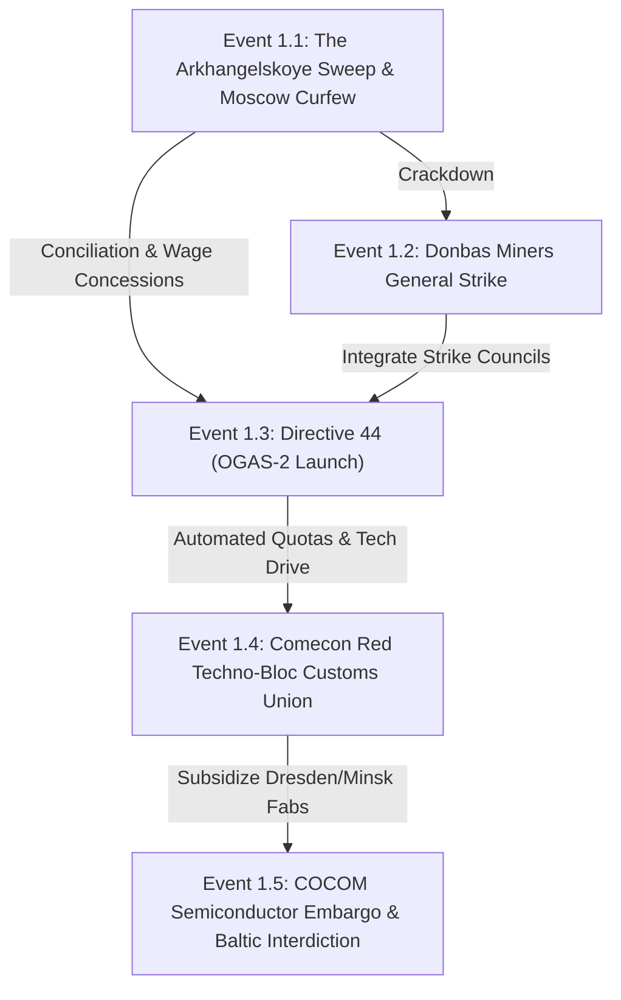
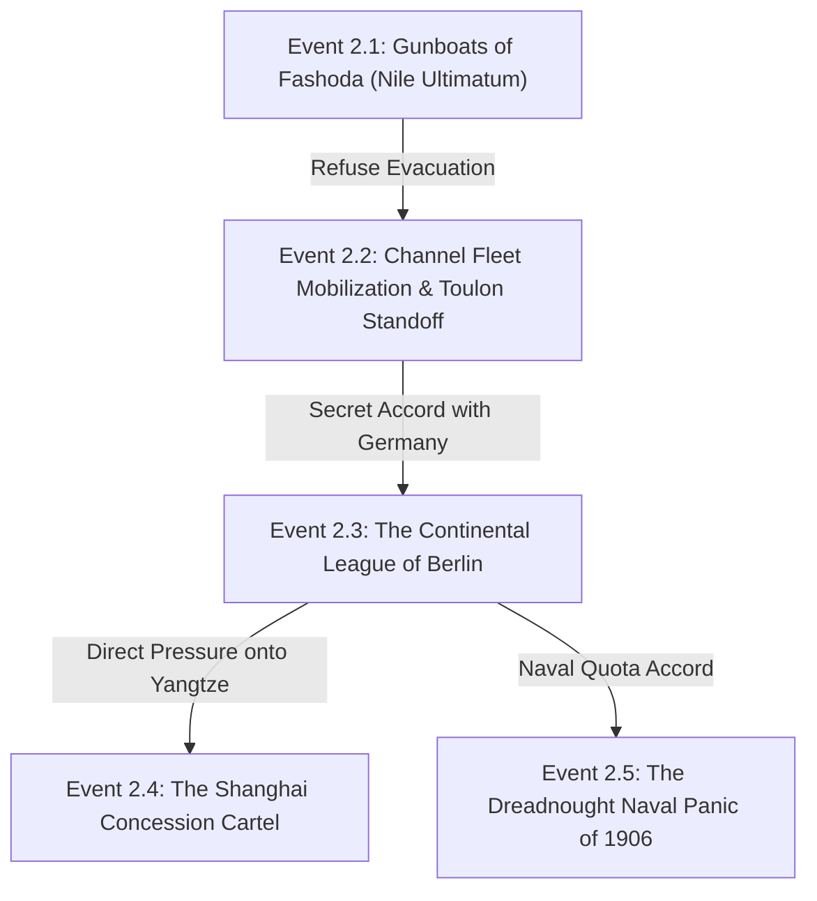
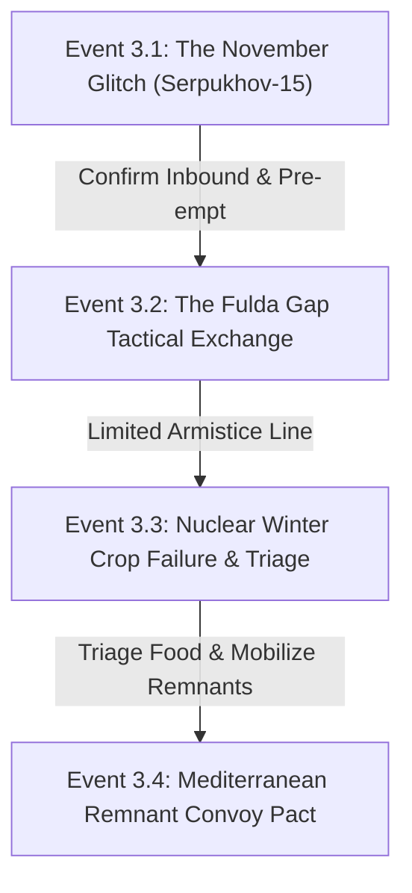
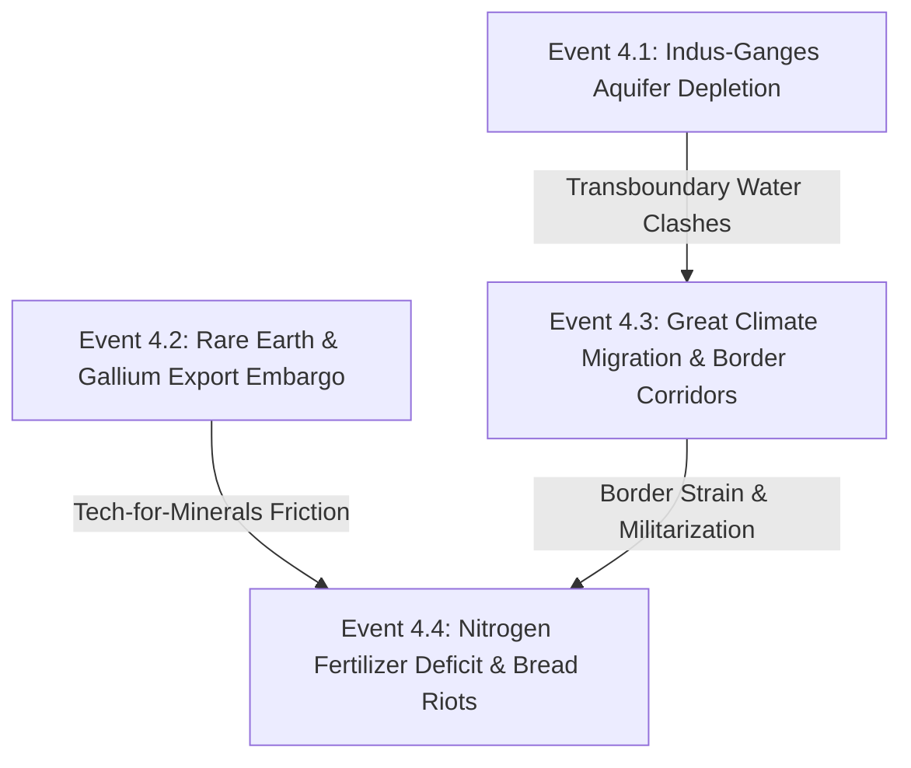
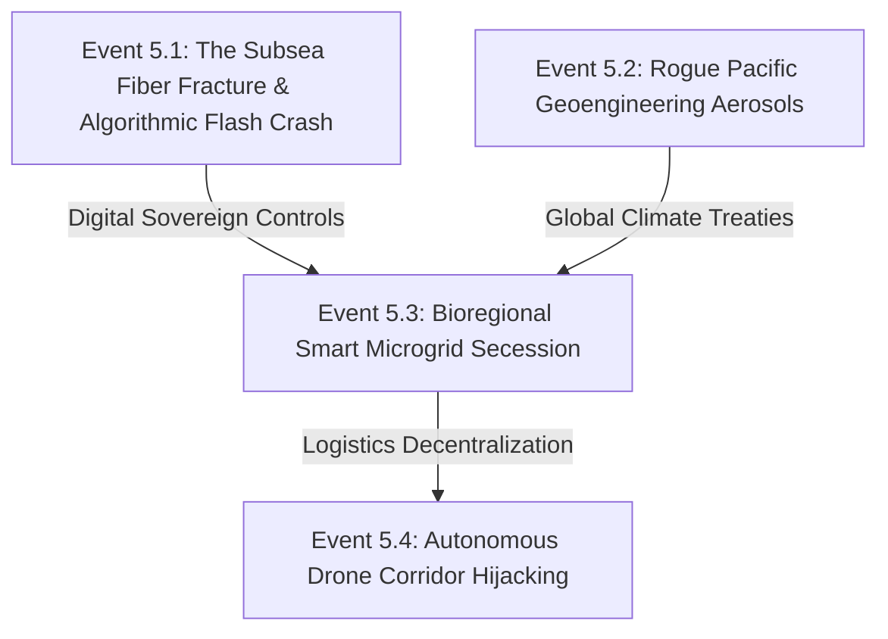
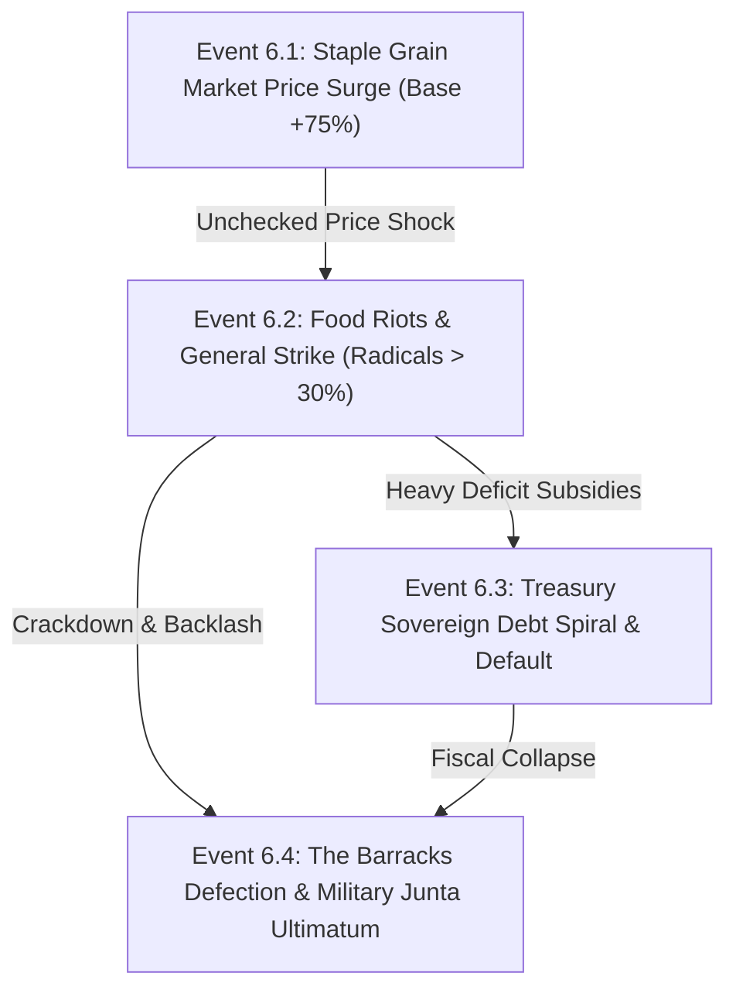

# Alternative History Event Chains & Living World Causality Engine
**SwiftHistoria Research & Mechanics Architecture Report**

---

## Executive Summary

This report delivers a comprehensive research framework and concrete content catalog of **26 interconnected event chains** for SwiftHistoria. These event chains span core scenarios and points of divergence (PODs):
1. **Soviet Triumph / Red Techno-Bloc (1991–1996)**: The August 1991 GKChP coup succeeds; Comecon cybernetic integration via OGAS-2; Cold War continuation and high-tech confrontation.
2. **Divided Sovereignty (1895–1912)**: Belle Époque imperial escalation starting at the 1898 Fashoda Incident, triggering the Continental League of Berlin, Dreadnought naval race, and Qing treaty port cartels.
3. **1983: Doomsday / Nuclear Crisis Escalation & Post-Exchange Survival (1983–1988)**: Able Archer 83 miscalculation, tactical nuclear release in Central Europe, nuclear winter harvest failure, and remnant Mediterranean authority triage.
4. **Resource Crucible & Fragmented Markets (2032–2038)**: Indus/Ogallala aquifer depletion, critical rare-earth export cartels, climate migration corridors, and fertilizer shortage bread riots.
5. **Pax Cybernetica & Solarpunk Dawn (2055–2062)**: Subsea fiber algorithmic flash crash, rogue Pacific geoengineering, bioregional smart microgrid secession, and autonomous freight drone corridor sabotage.
6. **Living World Dynamic Political-Economic Feedback Loops**: Victoria 3-inspired mechanics implemented in `NativeLivingWorldEngine.swift` (market price bounds, pop radicals, interest group approval thresholds, debt bankruptcy, and military junta ultimatums).

Every event adheres strictly to SwiftHistoria's mechanic protocol codebook:
- `⟦ECO⟧` Economic Resilience
- `⟦MKT⟧` Market Confidence
- `⟦STB⟧` Internal Stability
- `⟦SEC⟧` Security Anxiety
- `⟦DIP⟧` Diplomatic Leverage
- `⟦MIL⟧` Military Readiness
- `⟦TNS⟧` World Tension

---

## 1. Scenario Arc: Soviet Triumph / Red Techno-Bloc (1991–1996)

*Scenario ID: `soviet-triumph` | Opening Date: 1991-11-01 | Tone: Technocratic Bipolar Containment, Cybernetic Gosplan, Warsaw Pact Fortress.*

### Event 1.1: The Arkhangelskoye Sweep & Moscow Curfew
- **Era / Scenario**: 1991-08-20 / `soviet-triumph`
- **Narrative Summary**: In the early hours of August 19, 1991, KGB Alpha Group units intercept Boris Yeltsin at his Arkhangelskoye dacha before he can reach the Russian White House. The State Committee on the State of Emergency (GKChP) broadcasts classical music across Soviet television, declaring Mikhail Gorbachev incapacitated due to "acute illness." Tanks from the Tamanskaya and Kantemirovskaya divisions establish checkpoints along the Garden Ring in Moscow, imposing an immediate dawn-to-dusk curfew.
- **Track Mechanics**:
  - Primary: `⟦SEC⟧` (+2) Security Anxiety
  - Secondary: `⟦STB⟧` (-2) Internal Stability
- **Autonomous Progression**: If the player takes no action, Soviet AI loyalty tests purge 40% of the Russian Supreme Soviet; spontaneous protests in Leningrad and the Baltic capitals face heavy militia dispersal; Western bourses drop 3.8% on panic selling.
- **Interactive Player Decisions**:
  1. *Declare All-Union State of Emergency & Convene Military Tribunals*
     - Trade-offs: `⟦SEC⟧` +2, `⟦STB⟧` +1, `⟦DIP⟧` -3. Costs 3 Admin Capacity.
     - Follow-up: Triggers **Event 1.2: The Donbas Miners General Strike & Factory Lockouts**.
  2. *Broadcast Federation Compromise & Grant Immediate 30% Wage Increases*
     - Trade-offs: `⟦ECO⟧` -2, `⟦MKT⟧` +1, `⟦STB⟧` +2. Costs 2 Admin Capacity.
     - Follow-up: Triggers **Event 1.3: Directive 44: OGAS-2 Cybernetic Network Launch**.
  3. *Form Joint Coalition Directorate with Moderate Reform Technocrats*
     - Trade-offs: `⟦DIP⟧` +2, `⟦STB⟧` +1, `⟦MIL⟧` -2. Costs 2 Admin Capacity.
     - Follow-up: Postpones unrest; unlocks peaceful transition diplomatic track with European capitals.

---

### Event 1.2: The Donbas Miners General Strike & Factory Lockouts
- **Era / Scenario**: 1991-10-15 / `soviet-triumph`
- **Narrative Summary**: Defying the Moscow emergency decree, over 120,000 coal miners in the Donets Basin, Kuzbass, and Vorkuta extinguish blast furnaces and halt trainheads. Demanding free trade unions, real food in the worker cooperatives, and the abolition of GKChP decrees, the strike threatens to cut off coking coal to metallurgical plants in the Urals and heating gas across the western republics right as winter descends.
- **Track Mechanics**:
  - Primary: `⟦ECO⟧` (-3) Economic Resilience
  - Secondary: `⟦STB⟧` (-2) Internal Stability
- **Autonomous Progression**: Without intervention, Soviet industrial output drops 14% in a single quarter; thermal plants in Kiev and Kharkov resort to rolling brownouts; Warsaw Pact member states report severe fuel supply shortfalls.
- **Interactive Player Decisions**:
  1. *Deploy Internal Troops (VV MVD) to Seize Mineheads and Force Extraction*
     - Trade-offs: `⟦MIL⟧` +1, `⟦SEC⟧` +3, `⟦STB⟧` -3. Sets region to `guerrilla-control`.
     - Follow-up: Triggers armed partisan skirmishes and railway sabotage across western borderlands.
  2. *Index Miner Wages to Convertible Hard Currency and Surrender Mine Management to Worker Councils*
     - Trade-offs: `⟦ECO⟧` -3, `⟦MKT⟧` -2, `⟦STB⟧` +2. Drains 25% of gold reserves.
     - Follow-up: Triggers severe Ruble overhang hyperinflation.
  3. *Incorporate Independent Strike Committees into Gosplan's Digital Planning Councils*
     - Trade-offs: `⟦ECO⟧` -1, `⟦STB⟧` +2, `⟦MKT⟧` +1. Costs 4 Admin Capacity.
     - Follow-up: Triggers **Event 1.3: Directive 44: OGAS-2 Cybernetic Network Launch**.

---

### Event 1.3: Directive 44: OGAS-2 Cybernetic Network Launch
- **Era / Scenario**: 1992-04-12 / `soviet-triumph`
- **Narrative Summary**: Reviving Victor Glushkov’s legendary blueprint for all-state cybernetic economic management, the Council of Ministers issues Directive 44: the nationwide deployment of OGAS-2. Mainframe arrays in Moscow, Novosibirsk, and Kiev are linked to optical telecommunication trunks across 24,000 industrial enterprises. Automated input-output matrices bypass venal regional party bosses, optimizing steel, tractor, and fertilizer distribution in real-time.
- **Track Mechanics**:
  - Primary: `⟦ECO⟧` (+2) Economic Resilience
  - Secondary: `⟦MKT⟧` (+1) Market Confidence
- **Autonomous Progression**: Regional First Secretaries resist data centralization; black markets for spare parts pivot into mainframe time arbitrage; production throughput rises 4.2% while bureaucratic overhead falls 18%.
- **Interactive Player Decisions**:
  1. *Enforce Automated Quotas; Purge Obstructive Regional Party Secretariats*
     - Trade-offs: `⟦STB⟧` -2, `⟦ECO⟧` +3, `⟦SEC⟧` +1. Costs 3 Admin Capacity.
     - Follow-up: Triggers **Event 1.4: Comecon Red Techno-Bloc Customs Union**.
  2. *Permit Enterprise Autonomy to Trade Surpluses on Dual-Track Electronic Exchanges*
     - Trade-offs: `⟦MKT⟧` +2, `⟦ECO⟧` +1, `⟦STB⟧` -1.
     - Follow-up: Triggers algorithmic black-market speculation and shadow offshore capital conduits.
  3. *Channel Network Compute Capacity into Strategic Rocket Forces Defense Logistics*
     - Trade-offs: `⟦MIL⟧` +3, `⟦SEC⟧` -1, `⟦ECO⟧` -1.
     - Follow-up: Triggers NATO alert posture and military tension along the Fulda Gap.

---

### Event 1.4: Comecon Red Techno-Bloc Customs Union
- **Era / Scenario**: 1993-06-01 / `soviet-triumph`
- **Narrative Summary**: In East Berlin and Moscow, the member states of Comecon ratify the "Socialist High-Technology Integration Charter." The agreement binds East Germany (under reconstituted hardline leadership), Poland, Czechoslovakia, Bulgaria, and Cuba into a closed technological common market. Western semiconductor imports are officially prohibited, replaced by subsidized silicon wafer fabs in Dresden (Robotron) and Minsk (Integral), cleared using the new digital "Inforuble."
- **Track Mechanics**:
  - Primary: `⟦MKT⟧` (+2) Market Confidence
  - Secondary: `⟦DIP⟧` (+2) Diplomatic Leverage
- **Autonomous Progression**: Western consumer goods vanish from Eastern European shelves, replaced by durable domestic electronics; Comecon internal trade volume increases 22%; CIA and MI6 establish Baltic smuggling networks for advanced microprocessors.
- **Interactive Player Decisions**:
  1. *Subsidize High-Density Silicon Lithography Tooling in Dresden and Zelenograd*
     - Trade-offs: `⟦ECO⟧` +2, `⟦MIL⟧` +1, `⟦MKT⟧` -1. Costs 4 Admin Capacity.
     - Follow-up: Triggers **Event 1.5: COCOM Semiconductor Embargo & Baltic Interdiction**.
  2. *Offer Special Energy-for-Technology Concessions to Finland and Austria*
     - Trade-offs: `⟦DIP⟧` +3, `⟦MKT⟧` +2, `⟦TNS⟧` -1.
     - Follow-up: Breaks Western technological encirclement, fostering a neutral Nordic-Danubian trade corridor.
  3. *Mandate Standardized Warsaw Pact Military Integration Across All Electronics*
     - Trade-offs: `⟦MIL⟧` +3, `⟦SEC⟧` -2, `⟦ECO⟧` -2.
     - Follow-up: Sparks diplomatic friction with nationalist factions in Budapest and Warsaw.

---

### Event 1.5: COCOM Semiconductor Embargo & Baltic Interdiction
- **Era / Scenario**: 1994-09-18 / `soviet-triumph`
- **Narrative Summary**: In response to the Red Techno-Bloc's advances, the Coordinating Committee for Multilateral Export Controls (COCOM) announces a total maritime and aviation blockade on high-end dual-use technologies bound for Soviet ports. Royal Navy and Bundesmarine frigates begin stopping Polish and Soviet cargo carriers in the Kattegat and Danish Straits, demanding inspections of container manifests.
- **Track Mechanics**:
  - Primary: `⟦TNS⟧` (+3) World Tension
  - Secondary: `⟦MIL⟧` (+2) Military Readiness
- **Autonomous Progression**: Soviet Baltic Fleet destroyers deploy from Kaliningrad to shadow Western boarding parties; international marine insurance underwriters declare the Skagerrak a hazardous war zone.
- **Interactive Player Decisions**:
  1. *Deploy Submarine & Frigate Escort Flotillas with Shoot-on-Sight Orders*
     - Trade-offs: `⟦MIL⟧` +2, `⟦TNS⟧` +3, `⟦DIP⟧` -3. High risk of naval clash.
     - Follow-up: Escalates to a direct military standoff in the North Sea; risks armed maritime engagement.
  2. *Nationalize Western Joint Ventures and Confiscate On-Site Fabrication Tooling*
     - Trade-offs: `⟦ECO⟧` +1, `⟦MKT⟧` -3, `⟦DIP⟧` -2.
     - Follow-up: Triggers immediate freezing of all Soviet foreign bank assets in London and Zurich.
  3. *Route Critical Silicon Via Covert Siberian-Pacific Smuggling Conduits Through East Asia*
     - Trade-offs: `⟦DIP⟧` +1, `⟦ECO⟧` -1, `⟦SEC⟧` +1. Costs 3 Admin Capacity.
     - Follow-up: Stabilizes technological supplies; settles into an enduring, entrenched Cold War stalemate.

---

## 2. Scenario Arc: Divided Sovereignty / Belle Époque Imperial Powderkeg (1895–1912)

*Scenario ID: `divided-sovereignty` | Opening Date: 1895-01-01 | Tone: Multipolar Imperial Balancing, Mercantilist Spheres, Gunboat Diplomacy.*

### Event 2.1: The Gunboats of Fashoda: Nile Valley Ultimatum
- **Era / Scenario**: 1898-09-19 / `divided-sovereignty`
- **Narrative Summary**: On the mudbanks of the White Nile, Captain Jean-Baptiste Marchand's 150 Senegalese Tirailleurs hold the dilapidated mud-brick fort of Fashoda. General Horatio Herbert Kitchener arrives with five heavily armed Anglo-Egyptian steam gunboats, demanding the immediate lowering of the tricolor. Marchand refuses, declaring that only an order from the President of the French Republic will make him withdraw.
- **Track Mechanics**:
  - Primary: `⟦TNS⟧` (+3) World Tension
  - Secondary: `⟦DIP⟧` (-2) Diplomatic Leverage
- **Autonomous Progression**: Paris and London tabloids print vitriolic front pages; London crowd burns French flags outside the Embassy; naval reserves are recalled in Portsmouth and Toulon; Mediterranean grain freight rates jump 18%.
- **Interactive Player Decisions**:
  1. *Refuse Evacuation; Declare the Upper Nile an Inalienable French Protectorate*
     - Trade-offs: `⟦MIL⟧` +2, `⟦TNS⟧` +3, `⟦DIP⟧` -3.
     - Follow-up: Triggers **Event 2.2: Channel Fleet Mobilization & The Toulon Standoff**.
  2. *Cede Fashoda in Exchange for British Recognition in Morocco & Lake Chad*
     - Trade-offs: `⟦DIP⟧` +2, `⟦STB⟧` -2, `⟦TNS⟧` -2.
     - Follow-up: Averts immediate war; fosters Anglo-French entente; alienates Kaiser Wilhelm II.
  3. *Appeal to the Concert of Europe; Demand an International Cairo Conference*
     - Trade-offs: `⟦DIP⟧` +1, `⟦MKT⟧` +1, `⟦TNS⟧` -1. Costs 2 Admin Capacity.
     - Follow-up: Triggers Berlin’s diplomatic intervention as the balance-of-power arbiter.

---

### Event 2.2: Channel Fleet Mobilization & The Toulon Standoff
- **Era / Scenario**: 1898-11-04 / `divided-sovereignty`
- **Narrative Summary**: Following the rupture in diplomatic negotiations, the British Admiralty orders the Channel Fleet to sea with sealed war orders, while the Mediterranean Fleet concentrates at Malta. In response, the French Ministry of Marine assembles 14 pre-dreadnought battleships and a swarm of torpedo boats at Toulon and Brest. Lloyd’s of London suspends merchant vessel coverage across the Bay of Biscay.
- **Track Mechanics**:
  - Primary: `⟦MIL⟧` (+3) Military Readiness
  - Secondary: `⟦MKT⟧` (-3) Market Confidence
- **Autonomous Progression**: Coal depots in Cardiff, Gibraltar, and Dakar are put under armed guard; gold bullion begins flowing from Paris and London into New York commercial vaults; the Paris Bourse slides into panic.
- **Interactive Player Decisions**:
  1. *Order Pre-Emptive Torpedo-Boat Sorties Against the British Base at Gibraltar*
     - Trade-offs: `⟦MIL⟧` +3, `⟦TNS⟧` +4, `⟦MKT⟧` -4. Declares full colonial war.
     - Follow-up: Engages British Mediterranean fleet; triggers global commerce raiding across trade routes.
  2. *Sign Secret Strategic Maritime Pact with Berlin and St. Petersburg*
     - Trade-offs: `⟦DIP⟧` +3, `⟦SEC⟧` -1, `⟦ECO⟧` -1. Costs 3 Admin Capacity.
     - Follow-up: Triggers **Event 2.3: The Continental League of Berlin: The Kaiser’s Gambit**.
  3. *Accept the Demilitarized Bahr-el-Ghazal Compromise under American Mediation*
     - Trade-offs: `⟦STB⟧` -1, `⟦DIP⟧` +1, `⟦MKT⟧` +2.
     - Follow-up: De-escalates naval standoff; humbles French colonial lobby; causes domestic cabinet reshuffle.

---

### Event 2.3: The Continental League of Berlin: The Kaiser’s Gambit
- **Era / Scenario**: 1899-05-14 / `divided-sovereignty`
- **Narrative Summary**: Exploiting the bitter Anglo-French breach, Kaiser Wilhelm II and Chancellor von Bülow invite the plenipotentiaries of France and Russia to the Wilhelmstrasse. The Kaiser proposes the "Continental League": an alliance uniting the land and naval power of Germany, France, and Russia to check Great Britain's maritime supremacy and partition colonial commercial concessions.
- **Track Mechanics**:
  - Primary: `⟦DIP⟧` (+3) Diplomatic Leverage
  - Secondary: `⟦TNS⟧` (+2) World Tension
  - Secondary: `⟦MKT⟧` (+1) Market Confidence
- **Autonomous Progression**: Britain realizes its "splendid isolation" has transformed into a dangerous geopolitical encirclement; the British Cabinet authorizes emergency funding for the Two-Power Naval Standard; sterling fluctuates against the mark.
- **Interactive Player Decisions**:
  1. *Ratify the Tripartite Treaty and Establish Combined Naval Building Quotas*
     - Trade-offs: `⟦MIL⟧` +2, `⟦DIP⟧` +3, `⟦ECO⟧` -2. Costs 4 Admin Capacity.
     - Follow-up: Triggers **Event 2.5: The Dreadnought Panic of 1906: North Sea Naval Drills**.
  2. *Condition French Adherence on Territorial Concessions in Alsace-Lorraine*
     - Trade-offs: `⟦DIP⟧` -2, `⟦STB⟧` +2, `⟦TNS⟧` +1.
     - Follow-up: Destroys the conference; restores European multipolar friction; isolates France.
  3. *Direct Continental League Economic Muscle Against British Spheres in the Yangtze Valley*
     - Trade-offs: `⟦ECO⟧` +2, `⟦MKT⟧` +1, `⟦SEC⟧` +1.
     - Follow-up: Triggers **Event 2.4: The Shanghai Concession Cartel & Yangtze Railway Ultimatum**.

---

### Event 2.4: The Shanghai Concession Cartel & Yangtze Railway Ultimatum
- **Era / Scenario**: 1903-03-22 / `divided-sovereignty`
- **Narrative Summary**: Backed by the Continental League, German and French banking consortia challenge British monopoly rights over the lucrative Hankow-Canton and Shanghai railway concessions in Qing China. Gunboats bearing the flags of Germany, France, and Russia anchor off the Bund in Shanghai, delivering a joint ultimatum to the Qing Grand Council demanding equal mining, telegraph, and customs jurisdiction.
- **Track Mechanics**:
  - Primary: `⟦ECO⟧` (+2) Economic Resilience
  - Secondary: `⟦SEC⟧` (+2) Security Anxiety
- **Autonomous Progression**: Chinese Boxer remnants and secret societies mobilize along the Grand Canal; Qing imperial officials play the rival barbarian factions against one another; tea and silk export shipments stall.
- **Interactive Player Decisions**:
  1. *Dispatch Multinational Imperial Marine Detachments to Seize Rail Termini by Force*
     - Trade-offs: `⟦MIL⟧` +2, `⟦SEC⟧` +3, `⟦STB⟧` -2. Sets region to `conventional-occupation`.
     - Follow-up: Triggers widespread anti-foreign riots across Central China; threatens treaty port commerce.
  2. *Partner with the Anglo-Japanese Alliance to Form a Pacific Maritime Trade Clearing Syndicate*
     - Trade-offs: `⟦MKT⟧` +3, `⟦DIP⟧` +1, `⟦TNS⟧` -1.
     - Follow-up: Balances European continental power with Anglo-Japanese Pacific sea lanes.
  3. *Impose Joint International Customs Board with Mandatory Silver Standard Exchange*
     - Trade-offs: `⟦ECO⟧` +2, `⟦MKT⟧` +2, `⟦STB⟧` +1. Costs 3 Admin Capacity.
     - Follow-up: Stabilizes Chinese treaty port trade; locks in imperial revenue streams for decades.

---

### Event 2.5: The Dreadnought Panic of 1906: North Sea Naval Drills
- **Era / Scenario**: 1906-10-10 / `divided-sovereignty`
- **Narrative Summary**: The launch of HMS *Dreadnought* renders all existing battleships obsolete at a single stroke. Across the North Sea, the German Imperial Navy counters with the Nassau-class dreadnought program, while French dockyards in Brest lay down massive turbine-driven capital ships. A single turn of the screw obsolete thousands of guns, sparking an unprecedented peacetime fiscal arms race.
- **Track Mechanics**:
  - Primary: `⟦MIL⟧` (+3) Military Readiness
  - Secondary: `⟦ECO⟧` (-2) Economic Resilience
  - Secondary: `⟦TNS⟧` (+2) World Tension
- **Autonomous Progression**: Steel prices hit record highs; municipal social programs in Britain and Germany are slashed to finance 12-inch gun mountings; peace leagues organize massive dockyard strikes in Glasgow and Kiel.
- **Interactive Player Decisions**:
  1. *Authorize Six Emergency Super-Dreadnought Keels Regardless of Deficits*
     - Trade-offs: `⟦MIL⟧` +3, `⟦ECO⟧` -3, `⟦STB⟧` -2. Drains national treasury.
     - Follow-up: Triggers national fiscal austerity crises and widespread naval worker strikes.
  2. *Propose Formal Tonnage Limits and Mutual Inspections at The Hague Conference*
     - Trade-offs: `⟦DIP⟧` +3, `⟦TNS⟧` -2, `⟦MIL⟧` -1. Costs 3 Admin Capacity.
     - Follow-up: Averts imminent bankruptcy; signs the historic Hague Naval Limitation Accord.
  3. *Shift Doctrine to Asymmetric Submarine Mines, Coastal Torpedo Flotillas, and Cruisers*
     - Trade-offs: `⟦ECO⟧` +1, `⟦MIL⟧` +1, `⟦SEC⟧` +2.
     - Follow-up: Pioneers modern submarine warfare doctrine; weakens traditional battleship prestige.

---

## 3. Scenario Arc: 1983 Doomsday / Nuclear Escalation & Post-Exchange Survival (1983–1988)

*Scenario ID: `soviet-triumph` / `resource-crucible` | Opening Date: 1983-11-02 | Tone: Cold War Hair-Trigger, EMP Shock, Nuclear Winter Survival.*

### Event 3.1: The November Glitch: Serpukhov-15 Radar Ambiguity
- **Era / Scenario**: 1983-11-08 / `soviet-triumph` / `default`
- **Narrative Summary**: During NATO’s large-scale command exercise *Able Archer 83*, the Soviet early warning bunker at Serpukhov-15 detects five Minuteman ICBM launches from North America. Red alert klaxons wail. Duty officer Stanislav Petrov faces flashing computer screens reporting "LAUNCH" with highest reliability. Concurrently, KGB stations in London and Brussels report suspicious radio silence, which Moscow Center interprets as immediate pre-strike dispersal.
- **Track Mechanics**:
  - Primary: `⟦SEC⟧` (+4) Security Anxiety
  - Secondary: `⟦TNS⟧` (+4) World Tension
- **Autonomous Progression**: Soviet Strategic Rocket Forces prime solid-fuel SS-20 missiles in East Germany; Tu-22M Backfire bombers arm with thermonuclear AS-4 missiles on runway aprons; NATO theater commanders request nuclear release authority.
- **Interactive Player Decisions**:
  1. *Transmit Warning Confirmation to Moscow General Staff; Authorize Pre-emptive Strikes*
     - Trade-offs: `⟦MIL⟧` +4, `⟦TNS⟧` +5, `⟦STB⟧` -4.
     - Follow-up: Triggers **Event 3.2: The Fulda Gap Tactical Exchange**.
  2. *Override the System as a False Alarm; Direct Hotline Cable to the White House*
     - Trade-offs: `⟦DIP⟧` +3, `⟦TNS⟧` -3, `⟦SEC⟧` -2. Costs 3 Admin Capacity.
     - Follow-up: De-escalates crisis; triggers historical Able Archer stand-down and 1985 Geneva Summit.
  3. *Disperse Nuclear Arsenals to Camouflaged Rail Tracks and Hold on Alert Status*
     - Trade-offs: `⟦MIL⟧` +2, `⟦SEC⟧` +2, `⟦ECO⟧` -1.
     - Follow-up: Maintains intense DEFCON-1 standoff for 72 hours; strains command-and-control communications.

---

### Event 3.2: The Fulda Gap Tactical Exchange
- **Era / Scenario**: 1983-11-12 / `soviet-triumph`
- **Narrative Summary**: Pre-emptive Soviet SS-21 and SS-20 strikes obliterate NATO airbases at Ramstein and Bitburg. NATO responds with Pershing II and cruise missile strikes against Soviet staging areas, railway bottlenecks, and forward command bunkers across East Germany and Czechoslovakia. Over 110 tactical warheads detonate within six hours. Massive high-altitude EMP pulses blind communications across continental Europe from the English Channel to the Dnieper.
- **Track Mechanics**:
  - Primary: `⟦MIL⟧` (-3) Military Readiness
  - Secondary: `⟦SEC⟧` (+4) Security Anxiety
  - Secondary: `⟦ECO⟧` (-4) Economic Resilience
- **Autonomous Progression**: Civilian electrical grids collapse entirely; unguided refugee columns swarm autobahns, choking military logistics; fallout clouds drift east-northeast over Poland and Belarus; world financial markets cease operations.
- **Interactive Player Decisions**:
  1. *Authorize Full Strategic Counter-Value Launch on Continental Urban Centers*
     - Trade-offs: `⟦MIL⟧` -5, `⟦ECO⟧` -5, `⟦STB⟧` -5. Total devastation.
     - Follow-up: Global thermonuclear exchange; terminal campaign collapse into total nuclear fallout.
  2. *Declare Unilateral Ceasefire along the Weser-Rhine Redoubt and Dispatch Decontamination Units*
     - Trade-offs: `⟦SEC⟧` +2, `⟦MIL⟧` -2, `⟦STB⟧` +1. Costs 4 Admin Capacity.
     - Follow-up: Halts strategic escalation; creates permanent Central European nuclear fallout dead-zone.
  3. *Establish Military Enclaves and Impose Martial Law across Agricultural Hinterlands*
     - Trade-offs: `⟦STB⟧` +1, `⟦ECO⟧` -2, `⟦SEC⟧` +2.
     - Follow-up: Triggers **Event 3.3: Nuclear Winter Crop Failure & Triage**.

---

### Event 3.3: Nuclear Winter Crop Failure & Triage
- **Era / Scenario**: 1984-06-20 / `resource-crucible`
- **Narrative Summary**: Injected smoke, soot, and pulverized debris in the stratosphere drop northern hemisphere summer temperatures by 6.5°C. In Ukraine, the Volga Basin, and the American Midwest, killing frosts strike in mid-July. Global cereal reserves plunge to an unprecedented 11 days of consumption. Surviving military commands and national rump governments face an existential choice: which population zones to feed, and which to abandon to famine.
- **Track Mechanics**:
  - Primary: `⟦ECO⟧` (-4) Economic Resilience
  - Secondary: `⟦STB⟧` (-3) Internal Stability
- **Autonomous Progression**: Urban bread riots morph into armed sieges of military granaries; desperate city dwellers migrate into rural farming communes; barter economies replace fiat currencies.
- **Interactive Player Decisions**:
  1. *Implement War-Communism Requisitions: Seize All Rural Grain Stores for Industrial Enclaves*
     - Trade-offs: `⟦ECO⟧` +1, `⟦STB⟧` -4, `⟦SEC⟧` +3. Sets country to `guerrilla-control`.
     - Follow-up: Sparks armed agrarian peasant insurgencies across fertile farming valleys.
  2. *Triage Metropolitan Centers: Evacuate Productive Pops to Southern Agricultural Latitudes*
     - Trade-offs: `⟦STB⟧` -2, `⟦ECO⟧` +2, `⟦DIP⟧` +1. Costs 4 Admin Capacity.
     - Follow-up: Triggers **Event 3.4: Remnant Authorities & The Mediterranean Convoy Pact**.
  3. *Deploy Chemical & Synthetic Bio-Protein Fermentation Vats using Deep Coal Reserves*
     - Trade-offs: `⟦ECO⟧` +2, `⟦MKT⟧` +1, `⟦STB⟧` +1. Costs 3 Admin Capacity.
     - Follow-up: Stems mass starvation; builds early bio-industrial survivalist economy.

---

### Event 3.4: Remnant Authorities & The Mediterranean Convoy Pact
- **Era / Scenario**: 1986-04-15 / `resource-crucible`
- **Narrative Summary**: As the northern nuclear gloom begins to lift, surviving state authorities in Southern Europe, North Africa, and Anatolia organize the "Mediterranean Convoy Directorate." Operating out of undamaged ports in Alexandria, Naples, and Izmir, armed diesel tugs and repurposed merchant ships escort shipments of uncontaminated wheat, olive oil, and solar distillation parts under mutual defense pacts.
- **Track Mechanics**:
  - Primary: `⟦DIP⟧` (+2) Diplomatic Leverage
  - Secondary: `⟦MKT⟧` (+2) Market Confidence
  - Secondary: `⟦SEC⟧` (+1) Security Anxiety
- **Autonomous Progression**: Rogue pirate flotillas operating from the ruins of southern naval stations attempt to seize grain convoys; international gold sovereigns and fuel barrels become the standard unit of account.
- **Interactive Player Decisions**:
  1. *Mobilize Remaining Naval Frigates to Form Armed Sovereign Convoy Escorts*
     - Trade-offs: `⟦MIL⟧` +2, `⟦SEC⟧` -2, `⟦ECO⟧` -1. Costs 2 Admin Capacity.
     - Follow-up: Clears pirate flotillas; consolidates regional hegemony across maritime choke points.
  2. *Establish Neutral Red Crescent / Red Cross Maritime Sanctuaries in the Aegean*
     - Trade-offs: `⟦DIP⟧` +3, `⟦STB⟧` +2, `⟦MIL⟧` -1.
     - Follow-up: Restores international maritime law; invites neutral regional trade integration.
  3. *Monopolize Grain Distribution to Force Unification under a Mediterranean Hegemony*
     - Trade-offs: `⟦ECO⟧` +3, `⟦DIP⟧` -2, `⟦TNS⟧` +2.
     - Follow-up: Provokes regional coastal rebellions against grain-monopoly taxation.

---

## 4. Scenario Arc: Resource Crucible & Fragmented Markets (2032–2038)

*Scenario ID: `resource-crucible` / `fragmented-markets` | Opening Date: 2035-06-01 | Tone: Water Wars, Critical Mineral Cartels, Climate Migration.*

### Event 4.1: The Indus-Ganges Aquifer Depletion & Irrigation Moratorium
- **Era / Scenario**: 2032-05-18 / `resource-crucible`
- **Narrative Summary**: Satellite gravimetry confirms the catastrophic collapse of the Indus-Ganges mega-aquifer. Groundwater levels drop past 250 meters, leaving millions of tube-wells sucking air. State authorities declare a total moratorium on agricultural pumping in the Punjab, while downstream canals run dry. Riots erupt along headworks dams as cross-border tensions between regional nuclear neighbors flare into artillery exchanges.
- **Track Mechanics**:
  - Primary: `⟦ECO⟧` (-3) Economic Resilience
  - Secondary: `⟦TNS⟧` (+3) World Tension
- **Autonomous Progression**: Crop yields in the Indo-Gangetic plain plunge by 42%; millions of displaced farmers march toward urban agglomerations; staple basmati and wheat exports are embargoed overnight.
- **Interactive Player Decisions**:
  1. *Deploy Military Engineers to Seize Upstream Canal Sluices and Defend Headwaters*
     - Trade-offs: `⟦MIL⟧` +2, `⟦TNS⟧` +3, `⟦DIP⟧` -3. Sets region to `contested-border`.
     - Follow-up: Triggers **Event 4.3: The Great Climate Migration Corridors & Border Militarization**.
  2. *Issue Green Sovereign Bonds for Massive Nuclear-Powered Coastal Desalination Pipelines*
     - Trade-offs: `⟦ECO⟧` -2, `⟦MKT⟧` +2, `⟦STB⟧` +1. Costs 4 Admin Capacity.
     - Follow-up: Constructs permanent fresh-water infrastructure; resolves aquifer dependency over 4 turns.
  3. *Enforce Severe Water Rationing in Urban Metropolises to Keep Strategic Farms Alive*
     - Trade-offs: `⟦STB⟧` -3, `⟦ECO⟧` +1, `⟦SEC⟧` +2.
     - Follow-up: Triggers fierce municipal water strikes and urban civil disobedience.

---

### Event 4.2: The Rare Earth Export Ban & Gallium-Germanium Cartel
- **Era / Scenario**: 2033-08-11 / `fragmented-markets`
- **Narrative Summary**: Reacting to sweeping Western sanctions and microchip tool restrictions, the world’s leading critical mineral producers form the "Rare Earth & Critical Materials Cartel" (RECC). Effective immediately, all unrefined exports of gallium, germanium, dysprosium, and battery-grade lithium are halted. Global advanced electronics manufacturing stalls, shuttering electric vehicle and semiconductor fabrication plants in North America, Europe, and Japan.
- **Track Mechanics**:
  - Primary: `⟦MKT⟧` (-3) Market Confidence
  - Secondary: `⟦ECO⟧` (+2) Economic Resilience (Cartel States) / (-3) (Importing States)
- **Autonomous Progression**: High-tech stock indices plummet 12% in 48 hours; scrap metal salvage values soar; intelligence agencies launch cyber campaigns against processing facilities in the Atacama and Baotou.
- **Interactive Player Decisions**:
  1. *Nationalize Domestic Mine Tailings & Subsidize Acid-Leaching Facilities*
     - Trade-offs: `⟦ECO⟧` +2, `⟦STB⟧` -2, `⟦MKT⟧` +1. Costs 3 Admin Capacity.
     - Follow-up: Builds domestic independence over 3 turns at the cost of local environmental protests.
  2. *Deploy Naval Task Forces to Escort Commercial Freighters Through Mineral Shipping Lanes*
     - Trade-offs: `⟦MIL⟧` +2, `⟦TNS⟧` +3, `⟦DIP⟧` -2.
     - Follow-up: Triggers international maritime standoffs outside raw material ports.
  3. *Negotiate Technology-for-Minerals Bilateral Barter Agreements Under Sovereign Escrow*
     - Trade-offs: `⟦DIP⟧` +3, `⟦MKT⟧` +2, `⟦TNS⟧` -1. Costs 2 Admin Capacity.
     - Follow-up: Bypasses dollar clearing; establishes direct dual-currency supply pipelines.

---

### Event 4.3: The Great Climate Migration Corridors & Border Militarization
- **Era / Scenario**: 2034-07-04 / `resource-crucible`
- **Narrative Summary**: Unprecedented wet-bulb heatwaves exceeding 35°C scorch the Sahel, Mesoamerica, and South Asia. Over 18 million people abandon uninhabitable rural districts, coalescing into massive migration corridors moving toward temperate latitudes. In Southern Europe and along the US southern border, regional governments deploy automated surveillance blimps, sensor wire, and armored gendarmerie detachments.
- **Track Mechanics**:
  - Primary: `⟦SEC⟧` (+3) Security Anxiety
  - Secondary: `⟦STB⟧` (-3) Internal Stability
- **Autonomous Progression**: Transit states experience economic strain as humanitarian resources dry up; border fences are breached at multiple points; political polarization surges in receiving nations.
- **Interactive Player Decisions**:
  1. *Authorize Hard Militarized Exclusion Zones with Autonomous Drone Patrols*
     - Trade-offs: `⟦SEC⟧` +2, `⟦STB⟧` +1, `⟦DIP⟧` -3. Sets border to `stabilization`.
     - Follow-up: Provokes international trade sanctions and widespread domestic civic strikes.
  2. *Establish Managed Resettlement Agricultural Enclaves in Underpopulated Rural Provinces*
     - Trade-offs: `⟦ECO⟧` +2, `⟦STB⟧` -2, `⟦MKT⟧` +1. Costs 4 Admin Capacity.
     - Follow-up: Resolves agrarian labor shortages; triggers nativist political backlash.
  3. *Fund International Climate Refugee Camps in Buffer States with Generous Foreign Aid*
     - Trade-offs: `⟦DIP⟧` +2, `⟦ECO⟧` -2, `⟦SEC⟧` -1. Costs 3 Admin Capacity.
     - Follow-up: Externalizes humanitarian pressure; leaves government vulnerable to buffer-state extortion.

---

### Event 4.4: The Global Nitrogen Fertilizer Deficit & Sovereign Bread Riots
- **Era / Scenario**: 2035-11-20 / `resource-crucible` / `default`
- **Narrative Summary**: Chronic natural gas supply pinches and refinery attacks cause the shutdown of 35% of global Haber-Bosch ammonia plants. Fertilizer prices rise 240%, forcing farmers worldwide to slash application rates. Cereal yields drop drastically, sparking immediate bread riots across import-dependent megacities from Cairo to Jakarta.
- **Track Mechanics**:
  - Primary: `⟦STB⟧` (-3) Internal Stability
  - Secondary: `⟦ECO⟧` (-2) Economic Resilience
- **Autonomous Progression**: Supermarket shelves empty out; black-market grain hoarding spreads; trade unions declare general strikes demanding living wages and subsidized food staples.
- **Interactive Player Decisions**:
  1. *Introduce Universal Bread Subsidies and Price Caps Paid from National Reserves*
     - Trade-offs: `⟦STB⟧` +2, `⟦ECO⟧` -3, `⟦MKT⟧` -2. Drains treasury.
     - Follow-up: Calms street unrest; triggers fiscal deficit downgrade and currency devaluation.
  2. *Mobilize Riot Police and Impose Food Distribution Curfews with Armed Escorts*
     - Trade-offs: `⟦SEC⟧` +3, `⟦STB⟧` -3, `⟦MIL⟧` +1.
     - Follow-up: Hardens government control; risks mutiny among underpaid conscript units.
  3. *Sign Emergency Government-to-Government Grain Barter Deal with Agricultural Exporters*
     - Trade-offs: `⟦ECO⟧` +1, `⟦DIP⟧` -2, `⟦MKT⟧` +1. Costs 2 Admin Capacity.
     - Follow-up: Secures urban food supply; yields diplomatic leverage to supplier nations.

---

## 5. Scenario Arc: Pax Cybernetica & Solarpunk Dawn (2055–2062)

*Scenario ID: `pax-cybernetica` / `solarpunk-dawn` | Opening Date: 2055-08-18 | Tone: Corporate Algorithmic Hegemonies, Bioregional Commons, Rogue Geoengineering.*

### Event 5.1: The Subsea Fiber Fracture: Algorithmic Flash Crash
- **Era / Scenario**: 2055-10-09 / `pax-cybernetica`
- **Narrative Summary**: Autonomous undersea demolition drones cut twelve major trans-Atlantic fiber optic cables simultaneously off the coast of Ireland. Autonomous AI market makers, operating on high-frequency predictive liquidity models, find their synchronizations severed. Within 38 seconds, algorithmic sell loops vaporize \$4.2 trillion in synthetic assets across sovereign and corporate ledger networks.
- **Track Mechanics**:
  - Primary: `⟦MKT⟧` (-4) Market Confidence
  - Secondary: `⟦ECO⟧` (-2) Economic Resilience
- **Autonomous Progression**: Digital banks freeze transaction accounts; automated logistics terminals lock cargo containers; corporate DAOs initiate automated margin calls against municipal bonds.
- **Interactive Player Decisions**:
  1. *Activate Sovereign Emergency Kill-Switches: Halt All Private Algorithmic Trading*
     - Trade-offs: `⟦STB⟧` +2, `⟦MKT⟧` -3, `⟦ECO⟧` -1. Costs 3 Admin Capacity.
     - Follow-up: Prevents systemic banking collapse; prompts corporate exodus to offshore data havens.
  2. *Nationalize Telecommunications Infrastructure under Military Cyber Defense Command*
     - Trade-offs: `⟦MIL⟧` +2, `⟦SEC⟧` -2, `⟦STB⟧` -1. Costs 4 Admin Capacity.
     - Follow-up: Hardens communications security; incites decentralized underground hacker resistance.
  3. *Backstop Affected Algorithmic DAOs with Emergency Sovereign Digital Liquidity*
     - Trade-offs: `⟦MKT⟧` +3, `⟦ECO⟧` -3, `⟦STB⟧` -2.
     - Follow-up: Restores market liquidity; sparks massive public outrage over corporate bailouts.

---

### Event 5.2: The Rogue Aerosol Injection: Geoengineering Piracy in the Pacific
- **Era / Scenario**: 2058-03-14 / `solarpunk-dawn` / `pax-cybernetica`
- **Narrative Summary**: Operating from private floating aerodromes in international waters, an autonomous climate venture capital trust dispatches 80 high-altitude stratospheric tankers. The aircraft inject 2.5 million tons of sulfur dioxide into the upper atmosphere to drop equatorial temperatures and generate tradable cooling credits. The resulting shift in the Intertropical Convergence Zone threatens monsoon rains across Southeast Asia and Central America.
- **Track Mechanics**:
  - Primary: `⟦TNS⟧` (+3) World Tension
  - Secondary: `⟦DIP⟧` (-2) Diplomatic Leverage
- **Autonomous Progression**: Affected downwind states scramble fighter squadrons; international diplomatic protests overwhelm the UN Climate Council; speculative carbon cooling derivatives jump 400%.
- **Interactive Player Decisions**:
  1. *Scramble Interceptors to Interdict and Force Down the Geoengineering Tanker Fleet*
     - Trade-offs: `⟦MIL⟧` +2, `⟦TNS⟧` +3, `⟦DIP⟧` +1.
     - Follow-up: Shuts down unauthorized aerosol flights; sparks cyber retaliation from corporate sponsors.
  2. *Endorse the Aerosol Program and Claim Co-Sponsorship of Atmospheric Cooling Offsets*
     - Trade-offs: `⟦ECO⟧` +2, `⟦DIP⟧` -3, `⟦TNS⟧` +2.
     - Follow-up: Captures lucrative carbon credit revenues; triggers trade boycotts from damaged nations.
  3. *Convene Emergency International Assembly to Negotiate Global Albedo Governance*
     - Trade-offs: `⟦DIP⟧` +3, `⟦TNS⟧` -2, `⟦STB⟧` +1. Costs 3 Admin Capacity.
     - Follow-up: Establishes multilateral framework for sovereign geoengineering regulation.

---

### Event 5.3: The Smart Microgrid Cleavage: Bioregional Energy Secession
- **Era / Scenario**: 2060-06-21 / `solarpunk-dawn`
- **Narrative Summary**: Tired of corporate transmission surcharges and blackouts caused by algorithmic trading nodes, a federation of agricultural and municipal cooperatives across the Pacific Northwest and Rhine basin secedes from the centralized national grid. Linking community solar roofs, anaerobic digesters, and flow-battery arrays via open-source decentralized protocols, they declare all generated electricity an inalienable public commons.
- **Track Mechanics**:
  - Primary: `⟦STB⟧` (+2) Internal Stability
  - Secondary: `⟦ECO⟧` (+2) Economic Resilience
  - Secondary: `⟦MKT⟧` (-1) Market Confidence
- **Autonomous Progression**: Central electric utilities face bond defaults as their high-paying customer base evaporates; industrial factories in urban centers suffer localized power shortages; cooperative bioregions flourish.
- **Interactive Player Decisions**:
  1. *Legitimize Bioregional Microgrids and Form a Cooperative Public Energy Union*
     - Trade-offs: `⟦STB⟧` +3, `⟦ECO⟧` +2, `⟦MKT⟧` -2. Costs 3 Admin Capacity.
     - Follow-up: Unlocks Solarpunk governance reforms; stabilizes domestic standard of living.
  2. *Enforce Federal Grid Authority with National Guard Units to Reconnect Infrastructure*
     - Trade-offs: `⟦SEC⟧` +3, `⟦STB⟧` -3, `⟦MKT⟧` +1.
     - Follow-up: Triggers clandestine sabotage of power lines and widespread civil strikes.
  3. *Create Dual-Market Mechanism: Allow Bioregions to Sell Surplus Energy at Premium Rates*
     - Trade-offs: `⟦MKT⟧` +2, `⟦ECO⟧` +1, `⟦STB⟧` +1. Costs 2 Admin Capacity.
     - Follow-up: Bridges corporate power needs and cooperative independence smoothly.

---

### Event 5.4: The Autonomous Freight Drone Corridor Hijacking
- **Era / Scenario**: 2061-09-02 / `pax-cybernetica`
- **Narrative Summary**: Militant neo-luddite and environmental partisans employ GPS-spoofing arrays and electromagnetic pulses along the high-speed autonomous freight corridor between Rotterdam and the Ruhr. Over 150 automated electric freight pods and heavy cargo drones are forced off highways and landed in abandoned industrial parks, their high-tech payloads confiscated and redistributed.
- **Track Mechanics**:
  - Primary: `⟦SEC⟧` (+3) Security Anxiety
  - Secondary: `⟦MKT⟧` (-2) Market Confidence
- **Autonomous Progression**: Autonomous transport consortiums suspend driverless freight along the corridor; supply chain delays hit retail distribution centers; consumer goods prices rise 15%.
- **Interactive Player Decisions**:
  1. *Authorize Armed Autonomous Drone Escorts with Lethal Perimeter Defense Mandates*
     - Trade-offs: `⟦MIL⟧` +2, `⟦SEC⟧` +2, `⟦STB⟧` -2.
     - Follow-up: Reopens freight corridor; sparks armed guerrilla warfare along transportation spines.
  2. *Mandate Human-in-the-Loop Drivers and Rehire Unionized Logistics Personnel*
     - Trade-offs: `⟦STB⟧` +3, `⟦ECO⟧` -1, `⟦MKT⟧` -1. Costs 2 Admin Capacity.
     - Follow-up: Resolves security friction; drives up long-term freight shipping costs.
  3. *Reroute Cargo Through Deep Underground Maglev Freight Tunnels*
     - Trade-offs: `⟦ECO⟧` +2, `⟦SEC⟧` -2, `⟦ECO⟧` -3 (Capital Cost). Costs 4 Admin Capacity.
     - Follow-up: Safeguards cargo from surface attacks; strains infrastructure capital budget.

---

## 6. Scenario Arc: Living World Dynamic Causality Loops (Victoria-Style Mechanics)

*Applicable to all scenarios & day-tick simulation engine (`NativeLivingWorldEngine.swift`).*

### Event 6.1: The Staple Grain Market Price Surge (Base Price +75%)
- **Era / Scenario**: Dynamic Day-Tick Simulation / All Scenarios
- **Engine Trigger**: `LWMarket.resolveDay` detects staple food buy orders exceeding sell orders by >100%; grain price hits clamped upper ceiling of `basePrice * 1.75` for 7 consecutive days.
- **Narrative Summary**: A severe imbalance in agricultural commodity markets forces grain prices to their theoretical maximum under national exchange rules. Poorer pops across lower strata spend more than 65% of their daily wages on subsistence flour and bread alone. Standard of Living (SoL) indices plummet, and the daily radicalization counter spikes.
- **Track Mechanics**:
  - Primary: `⟦ECO⟧` (-2) Economic Resilience
  - Secondary: `⟦STB⟧` (-3) Internal Stability
- **Autonomous Progression**: Pop wealth drains at maximum rates; Trade Unions and Marginalized pops lose approval rapidly; daily radical influx reaches +2.5% of total population per week.
- **Interactive Player Decisions**:
  1. *Subsidize Consumer Bread Directly from Treasury Cash Reserves*
     - Trade-offs: `⟦STB⟧` +2, `⟦ECO⟧` -2. Drains \$50k daily from national treasury.
     - Follow-up: Dampens unrest; if sustained without taxes, triggers **Event 6.3: Treasury Sovereign Debt Spiral & Default**.
  2. *Slash Food Import Tariffs and Deregulate Agricultural Imports*
     - Trade-offs: `⟦MKT⟧` +2, `⟦ECO⟧` -1, `⟦STB⟧` -1 (Landowners IG alienated).
     - Follow-up: Reduces food prices over 10 days; alienates agrarian political interest groups.
  3. *Ignore Price Spikes and Deploy Gendarmerie to Protect Market Silos*
     - Trade-offs: `⟦SEC⟧` +2, `⟦STB⟧` -3. Costs 0 Treasury.
     - Follow-up: Triggers **Event 6.2: Food Riots & General Strike**.

---

### Event 6.2: The Food Riots & General Strike (Radicals > 30%)
- **Era / Scenario**: Dynamic Day-Tick Simulation / All Scenarios
- **Engine Trigger**: `radicals / population > 0.30` and `stability < 40`.
- **Narrative Summary**: Fueled by chronic food insecurity and plunging living standards, wildcat strikes spread across railways, ports, and steelworks. Tens of thousands of demonstrators gather outside the ministry of the interior. Trade union leaders threaten a permanent general strike unless emergency wage floors, price caps, and democratic electoral guarantees are conceded.
- **Track Mechanics**:
  - Primary: `⟦STB⟧` (-4) Internal Stability
  - Secondary: `⟦SEC⟧` (+3) Security Anxiety
- **Autonomous Progression**: National industrial output drops to zero as factories idle; tax revenues collapse by 70%; police barracks are surrounded by picketers; government legitimacy slides into the "Alarmed" band (<25).
- **Interactive Player Decisions**:
  1. *Enact Radical Labor Reforms: Pass Minimum Wage & Subsidized Housing Charters*
     - Trade-offs: `⟦STB⟧` +3, `⟦ECO⟧` -2, `⟦MKT⟧` -2 (Industrialists IG approval -2).
     - Follow-up: Halts strikes; alienates capital owners, risking industrial capital flight.
  2. *Declare National Martial Law & Mobilize Armed Forces to Disperse Pickets*
     - Trade-offs: `⟦MIL⟧` +2, `⟦SEC⟧` +3, `⟦STB⟧` -3.
     - Follow-up: If Armed Forces IG approval is low, triggers **Event 6.4: The Barracks Defection & Military Junta Ultimatum**.
  3. *Form National Coalition Government: Invite Labor Leaders into Executive Cabinet*
     - Trade-offs: `⟦STB⟧` +2, `⟦DIP⟧` +1, `⟦MKT⟧` -1. Costs 3 Admin Capacity.
     - Follow-up: Rebuilds government legitimacy to Moderate; initiates new law enactment cycle.

---

### Event 6.3: The Treasury Sovereign Debt Spiral & Default
- **Era / Scenario**: Dynamic Day-Tick Simulation / All Scenarios
- **Engine Trigger**: `treasury <= 0`, `debt >= creditLimit`, weekly interest cannot be serviced.
- **Narrative Summary**: Strained by emergency subsidies, military mobilizations, and shrinking tax receipts, the state's gold reserves are exhausted. Commercial banks refuse further bond issues, and national credit ratings fall to junk status. Foreign creditors threaten economic sanctions and port seizures unless immediate fiscal austerity is enforced.
- **Track Mechanics**:
  - Primary: `⟦MKT⟧` (-4) Market Confidence
  - Secondary: `⟦ECO⟧` (-3) Economic Resilience
- **Autonomous Progression**: Sovereign borrowing rates rise by 50%; building construction halts immediately; national currency loses 35% of its foreign exchange purchasing power; import costs explode.
- **Interactive Player Decisions**:
  1. *Declare Formal Sovereign Bankruptcy & Repudiate Foreign Debt*
     - Trade-offs: `⟦ECO⟧` +2, `⟦MKT⟧` -5, `⟦DIP⟧` -4.
     - Follow-up: Clears accumulated national debt; cuts country off from foreign loans for 20 turns.
  2. *Accept International Creditor Bailout with Brutal Austerity Conditions*
     - Trade-offs: `⟦MKT⟧` +2, `⟦STB⟧` -4, `⟦ECO⟧` -2.
     - Follow-up: Restores foreign credit; ignites violent anti-austerity street demonstrations.
  3. *Nationalize Central Bank Reserves and Impose Strict Capital Export Controls*
     - Trade-offs: `⟦ECO⟧` +1, `⟦MKT⟧` -3, `⟦SEC⟧` +2. Costs 3 Admin Capacity.
     - Follow-up: Preserves domestic cash reserves; encourages black-market foreign exchange syndicates.

---

### Event 6.4: The Barracks Defection & Military Junta Ultimatum
- **Era / Scenario**: Dynamic Day-Tick Simulation / All Scenarios
- **Engine Trigger**: Government legitimacy < 25, Armed Forces IG approval <= -1, military budget deficit or protracted war exhaustion > 60.
- **Narrative Summary**: Armor and mechanized infantry columns surround the presidential palace and parliament house before dawn. General staff officers enter the prime minister’s office with an ultimatum: surrender all executive powers to a "Military Council of National Salvation" or face immediate storming of the executive complex.
- **Track Mechanics**:
  - Primary: `⟦MIL⟧` (+3) Military Readiness
  - Secondary: `⟦STB⟧` (-4) Internal Stability
  - Secondary: `⟦SEC⟧` (+3) Security Anxiety
- **Autonomous Progression**: If unaddressed, civilian cabinet members are placed under house arrest; constitution is suspended; international alliances are placed under review; infamy rises by +15.
- **Interactive Player Decisions**:
  1. *Cede Power to the Junta: Assume Leadership of the Military Council*
     - Trade-offs: `⟦MIL⟧` +3, `⟦SEC⟧` -2, `⟦DIP⟧` -3, `⟦STB⟧` +1.
     - Follow-up: Changes government type to Military Dictatorship; suppresses radicals with heavy hand.
  2. *Rally Loyal Gendarmerie & Arm Trade Union Militias to Defend the Capital*
     - Trade-offs: `⟦SEC⟧` +4, `⟦STB⟧` -4, `⟦MIL⟧` -2. Splits armed forces.
     - Follow-up: Triggers full-scale urban civil war; splits military regiments into opposing factions.
  3. *Negotiate Military Council Oversight Board while Retaining Civilian Cabinet*
     - Trade-offs: `⟦DIP⟧` +2, `⟦STB⟧` +1, `⟦MIL⟧` +1. Costs 4 Admin Capacity.
     - Follow-up: Preserves constitutional framework under heavy armed forces veto power.

---

## 7. Comparative Track Mechanics Matrix

The following table summarizes all 26 events, their core scenario affiliation, mechanic tracks, and behavioral progression:

| Event ID | Event Title | Scenario | Primary Track | Secondary Track | Autonomous Driver | Player Branch Outcomes |
|---|---|---|---|---|---|---|
| **E1.1** | Arkhangelskoye Sweep | Soviet Triumph | `⟦SEC⟧` +2 | `⟦STB⟧` -2 | KGB arrest sweep | Tribunals / Compromise / Coalition |
| **E1.2** | Donbas Miners Strike | Soviet Triumph | `⟦ECO⟧` -3 | `⟦STB⟧` -2 | Coal production halt | Police Force / Currency Pay / OGAS Councils |
| **E1.3** | Directive 44 (OGAS-2) | Soviet Triumph | `⟦ECO⟧` +2 | `⟦MKT⟧` +1 | Enterprise mainframe links | Purge Bureaucrats / Dual Markets / Military Compute |
| **E1.4** | Comecon Red Techno-Bloc | Soviet Triumph | `⟦MKT⟧` +2 | `⟦DIP⟧` +2 | Western chip embargo | Dresden Tooling / Finnish Neutrality / Pact Quotas |
| **E1.5** | COCOM Embargo Crisis | Soviet Triumph | `⟦TNS⟧` +3 | `⟦MIL⟧` +2 | Skagerrak naval stops | Escort Flotillas / Asset Seizures / Siberian Smuggling |
| **E2.1** | Gunboats of Fashoda | Divided Sovereignty | `⟦TNS⟧` +3 | `⟦DIP⟧` -2 | Nile confrontation | Hold Nile / Morocco Trade / Concert Conference |
| **E2.2** | Channel Fleet Mobilization | Divided Sovereignty | `⟦MIL⟧` +3 | `⟦MKT⟧` -3 | Channel Fleet war orders | Torpedo Sortie / Berlin Accord / American Mediation |
| **E2.3** | Continental League | Divided Sovereignty | `⟦DIP⟧` +3 | `⟦TNS⟧` +2 | Tripartite Berlin summit | Naval Quotas / Alsace Demands / Yangtze Pressure |
| **E2.4** | Shanghai Concession Cartel | Divided Sovereignty | `⟦ECO⟧` +2 | `⟦SEC⟧` +2 | Rail concession friction | Marine Seizures / Pacific Cartel / Silver Currency Peg |
| **E2.5** | Dreadnought Panic of 1906 | Divided Sovereignty | `⟦MIL⟧` +3 | `⟦ECO⟧` -2 | Capital ship obsolescence | Super-Dreadnoughts / Hague Limits / Submarine Doctrine |
| **E3.1** | November Glitch (Serpukhov-15)| 1983 Doomsday | `⟦SEC⟧` +4 | `⟦TNS⟧` +4 | Satellite radar anomaly | Nuclear Release / False Alarm / Rail Dispersal |
| **E3.2** | Fulda Gap Tactical Exchange | 1983 Doomsday | `⟦MIL⟧` -3 | `⟦SEC⟧` +4 | 110 tactical warheads | Strategic Escalation / Rhine Ceasefire / Farm Enclaves |
| **E3.3** | Nuclear Winter Harvest Shock | 1983 Doomsday | `⟦ECO⟧` -4 | `⟦STB⟧` -3 | 6.5°C temperature drop | Grain Requisitions / City Evacuation / Bio-Protein Vats |
| **E3.4** | Mediterranean Convoy Pact | 1983 Doomsday | `⟦DIP⟧` +2 | `⟦MKT⟧` +2 | Uncontaminated shipping | Frigate Escorts / Red Crescent Sanctuaries / Granary Monopoly |
| **E4.1** | Indus Aquifer Depletion | Resource Crucible | `⟦ECO⟧` -3 | `⟦TNS⟧` +3 | Tube-well water failure | Sluice Seizure / Desalination Pipelines / Urban Rationing |
| **E4.2** | Rare Earth Export Ban | Fragmented Markets | `⟦MKT⟧` -3 | `⟦ECO⟧` +2 | Critical minerals cartel | Tailings Leaching / Naval Escorts / Tech Barter Escrow |
| **E4.3** | Great Climate Migration | Resource Crucible | `⟦SEC⟧` +3 | `⟦STB⟧` -3 | Wet-bulb heatwaves | Militarized Border / Rural Resettlement / Buffer Camps |
| **E4.4** | Nitrogen Fertilizer Deficit | Resource Crucible | `⟦STB⟧` -3 | `⟦ECO⟧` -2 | Ammonia plant closures | Bread Subsidies / Police Curfews / Inter-State Barter |
| **E5.1** | Subsea Fiber Flash Crash | Pax Cybernetica | `⟦MKT⟧` -4 | `⟦ECO⟧` -2 | Cable severance cascade | Sovereign Kill-Switch / Military Net / DAO Bailouts |
| **E5.2** | Rogue Pacific Geoengineering | Solarpunk Dawn | `⟦TNS⟧` +3 | `⟦DIP⟧` -2 | SO2 tanker dispersion | Scramble Fighters / Carbon Offsets / Quito Treaty |
| **E5.3** | Smart Microgrid Secession | Solarpunk Dawn | `⟦STB⟧` +2 | `⟦ECO⟧` +2 | Community solar cutoffs | Bioregional Union / National Guard / Dual-Tariff Energy |
| **E5.4** | Freight Drone Hijacking | Pax Cybernetica | `⟦SEC⟧` +3 | `⟦MKT⟧` -2 | GPS-spoofing ambushes | Drone Swarms / Unionized Drivers / Maglev Tunnels |
| **E6.1** | Staple Grain Price Surge | Living World Loop | `⟦ECO⟧` -2 | `⟦STB⟧` -3 | Price ceiling hit (+75%) | Bread Subsidies / Tariff Cut / Force Protection |
| **E6.2** | Food Riots & General Strike | Living World Loop | `⟦STB⟧` -4 | `⟦SEC⟧` +3 | Radicals > 30% | Labor Reforms / Martial Law / National Cabinet |
| **E6.3** | Sovereign Debt Default | Living World Loop | `⟦MKT⟧` -4 | `⟦ECO⟧` -3 | Treasury exhausted | Declare Bankruptcy / IMF Austerity / Capital Controls |
| **E6.4** | Barracks Defection / Junta | Living World Loop | `⟦MIL⟧` +3 | `⟦STB⟧` -4 | Legitimacy < 25 | Cede to Junta / Civil War Defense / Oversight Compromise |

---

## 8. Implementation Notes for SwiftHistoria Integration

To integrate these event chains into SwiftHistoria's native architecture:
1. **Model Structs (`NativeCampaignModels.swift`)**:
   - `NativeCampaignEvent` already supports `strategicEffects` typed to `NativeStrategicTrack`, with magnitudes and targets.
   - Event chains can be formally indexed using `chainID: String?`, `stepIndex: Int?`, and `preconditionEventID: String?`.
2. **Deterministic Day-Tick Evaluator (`NativeLivingWorldTick.swift`)**:
   - For Living World loops (E6.1–E6.4), the state condition thresholds directly bind to `LWMarket.goods["grain"].price`, `country.radicals / country.population`, and `country.treasury`.
3. **Foundation Model & Decision Matrix Synergy (`NativeWorldSimulator.swift`)**:
   - When consequence events fire, `validatedPlayerMatrix` ensures the 2–3 interactive options are generated with distinct primary/secondary mechanic tokens (`⟦ECO⟧`, `⟦SEC⟧`, etc.), feeding into subsequent turn reports.
